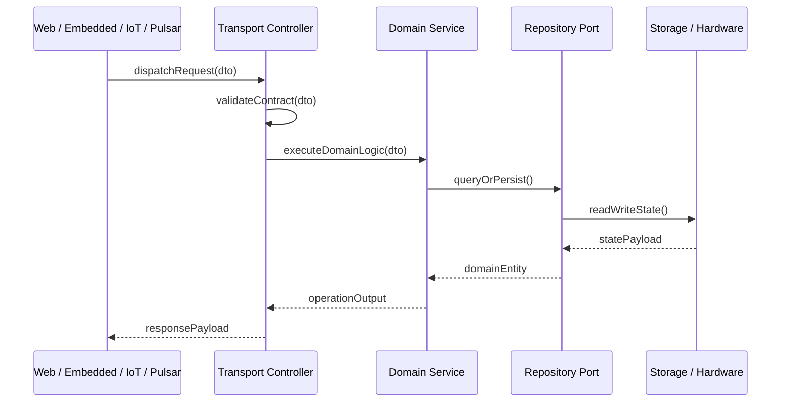

<p align="center"></p>

<h1 align="center">Orion</h1>
<p align="center"><strong>Sovereign protocol-agnostic universal service framework and modular runtime in pure native Rust</strong></p>

<p align="center">
  
  
  
  
  <a href="LICENSE"></a>
  <a href="https://natuleadan.com"></a>
</p>

## 1. What is Orion?

Orion is a sovereign, protocol-agnostic universal framework and modular runtime engineered entirely in native Rust. Rather than locking applications into a single transport, Orion lets consumers configure the exact multiplexer and wire protocol at integration time—supporting REST, WebSocket/WSS, gRPC, and lightweight embedded/IoT transports—while providing factored schemas and reusable patterns to accelerate service construction across web servers, third-party bridges, and diverse microcontrollers and chips.

### What is inside

Orion implements a layered six-file modular domain layout (`entity`, `dto`, `repository`, `service`, `controller`, `mod`) atop a pure-Cargo workspace (`crates/core` and `crates/xtask`). Pluggable transport adapters and compatibility layers decouple core business contracts from specific device or network targets, governed by eight native validation gates and a 3-day dependency cooldown.

> **Current scope:** This release ships the native validation harness, the six-file modular reference domain (`modules/math`), and the crate contracts. Transports, sandboxes, domain engines and protocol integrations described below are planned milestones, not shipped capabilities.

## 2. Why Orion?

Traditional service frameworks lock teams into heavy web-only runtimes, verbose YAML manifests, and single-protocol assumptions that cannot span heterogeneous hardware.

- **Configurable transport & multiplexer**: Select and configure REST, WebSocket/WSS, gRPC, or constrained hardware transports when consuming the crate without rewriting domain logic.
- **Factored schemas & universal patterns**: Reusable code-first contracts dramatically reduce service-building time across web, server, and embedded targets.
- **Multi-device compatibility layers**: Expose identical domain contracts across cloud endpoints, third-party integrations, and diverse microcontrollers and chips.
- **Architectural boundary tripwires**: Unidirectional dependencies between controllers, services, and repositories are enforced by automated tests.

## 3. Highlights

- **layered modular architecture**: Clean domain modules with strictly unidirectional dependencies.
- **Protocol-agnostic service abstraction**: Uniform domain contracts adaptable to REST, WSS, gRPC, serial/embedded, and IoT transports.
- **Pure Cargo automation via `xtask`**: Native commands (`cargo xtask validate`, `cargo xtask notices`, `cargo xtask release`) with zero script bloat.
- **Supply-chain hardening**: Enforced 3-day dependency publish cooldown (`resolver.min-publish-age="3 days"`), CodeQL analysis, and automated SBOM generation.
- **Zero formatter drift**: Automated formatters are excluded from hooks and CI so diffs stay focused on engineering logic.

## 4. Quick Start

Ensure Rust `1.85+` (Rust 2024 edition / stable, matching `rust-version = "1.85"`) is installed:

```bash
# Clone the repository
git clone https://github.com/natuleadan/orion.git
cd orion

# Activate local hooks
git config core.hooksPath .githooks

# Run the complete 8-gate native validation suite
cargo xtask validate
```

Other native `xtask` operations:

```bash
cargo xtask notices          # Regenerate ThirdPartyNotices.txt from cargo metadata
cargo xtask release --check  # Verify Cargo.toml version and CHANGELOG parity
cargo test --workspace       # Execute unit, integration, and architecture tests
```

## 5. Use Cases

- **Decoupled service backbone**: Expose protocol-agnostic endpoints (REST, WSS, gRPC) alongside Andromeda to power Pulsar agent swarms without direct crate coupling.
- **Robotic & multi-hardware control services**: Provide factored schemas and service patterns for Pleaides robotic mobility and diverse microcontrollers and edge chips.
- **Third-party & web integrations**: Expose deterministic, type-safe endpoints for external applications and distributed services.

## 6. How It Works



Requests from any target device or client enter through a transport `controller`, validate input contracts via `dto`, execute business rules inside `service`, and persist or control state through `repository` ports.

## 7. Status and Roadmap

- **Status**: Initial foundation — validation harness and modular reference skeleton in place; domain implementation in progress.
- **Milestone 1**: Code-first routing, validation, and multi-device compatibility trait layers.
- **Milestone 2**: Embedded multi-microcontroller `no_std`-friendly core contracts and multi-transport adapters.
- **Milestone 3**: Full wire-protocol interoperability (REST, WSS, gRPC) with Andromeda, Pulsar, and Pleaides.

## 8. Repository Layout & Validation Gates

```text
.
├── .cargo/                  # Cargo configuration and 3-day cooldown resolver
├── .githooks/               # Versioned commit-msg, pre-commit, and pre-push hooks
├── .github/                 # Issue templates, dependabot config, and CI workflows
├── crates/
│   ├── core/                # Core domain library (modules/math reference domain, lib.rs)
│   │   └── tests/           # integration.rs and immutable architecture.rs tripwires
│   └── xtask/               # Pure-Rust automation CLI (cargo xtask <cmd>)
├── .env.example             # Environment contract template (copy to git-ignored .env)
├── Cargo.toml               # Workspace manifest (rust-version = "1.85", [workspace.lints])
├── clippy.toml              # Strict Clippy policy (max-fn-params-bools = 0)
├── ARCHITECTURE.md          # Modular domain architecture specifications
├── AGENTS.md                # Autonomous AI agent operating guidelines
├── CONTRIBUTING.md          # Contribution workflow and commit grammar
├── SECURITY.md              # Supply-chain policies and vulnerability reporting
├── LICENSE                  # Apache-2.0 License
├── NOTICE                   # Copyright (c) 2026 Natuleadan.
└── ThirdPartyNotices.txt    # Automated third-party license inventory
```

| Gate | Command | Purpose |
| :--- | :--- | :--- |
| `lint` | `cargo clippy --workspace --all-targets --all-features -- -D warnings` + `cargo doc -D warnings` | Strict zero-warning static analysis and rustdoc checks |
| `typecheck` | `cargo check --workspace --all-targets` | Workspace type verification |
| `unit tests` | `cargo test --workspace --lib` + `--doc` | Library unit tests and runnable doc examples |
| `integration and architecture tests` | `cargo test --workspace --test '*'` | Integration flows and layer tripwires |
| `cooldown` | `cargo --config 'resolver.min-publish-age="3 days"'` | 3-day package release cooldown |
| `hygiene` | `crates/xtask/src/hygiene.rs` | 500-line limit, anti-leak, and syntax checks |
| `notices` | `crates/xtask/src/notices.rs` | License inventory parity check |
| `release` | `crates/xtask/src/release.rs` | SemVer and CHANGELOG consistency |

## 9. Documentation

- [ARCHITECTURE.md](ARCHITECTURE.md): Modular architecture, layer constraints, and design invariants.
- [CONTRIBUTING.md](CONTRIBUTING.md): Issue-first contribution policy, PR workflow, and commit grammar.
- [SECURITY.md](SECURITY.md): Vulnerability disclosure procedures and supply-chain guarantees.
- [AGENTS.md](AGENTS.md): Machine-facing instructions for autonomous engineering.

## 10. Ecosystem & Community

Orion provides the protocol-agnostic service framework and factored patterns of Natuleadan, interoperating over decoupled wire protocols (REST, WSS, gRPC) with Andromeda, Aurora, Pleaides, Pulsar, Caelum, Lyra, and Skills.

<p align="left">
  <a href="https://github.com/natuleadan"></a>
  <a href="https://github.com/leojara95"></a>
</p>

Bug reports and feature proposals are tracked via structured GitHub Issues.

## 11. Contributing

External pull requests are restricted to maintainers (`collaborators_only`). Please open an issue describing your bug or proposal. See [CONTRIBUTING.md](CONTRIBUTING.md) for details.

## 12. License & Star History

This project is licensed under the Apache License 2.0. Copyright (c) 2026 Natuleadan.

Terms are in [LICENSE](LICENSE), attribution in [NOTICE](NOTICE), and third-party dependency notices in [ThirdPartyNotices.txt](ThirdPartyNotices.txt).

<a href="https://www.star-history.com/#natuleadan/orion&Date">
  <picture>
    <source media="(prefers-color-scheme: dark)" srcset="https://api.star-history.com/image?repos=natuleadan/orion&type=date&theme=dark" />
    <source media="(prefers-color-scheme: light)" srcset="https://api.star-history.com/image?repos=natuleadan/orion&type=date&theme=light" />
    
  </picture>
</a>
